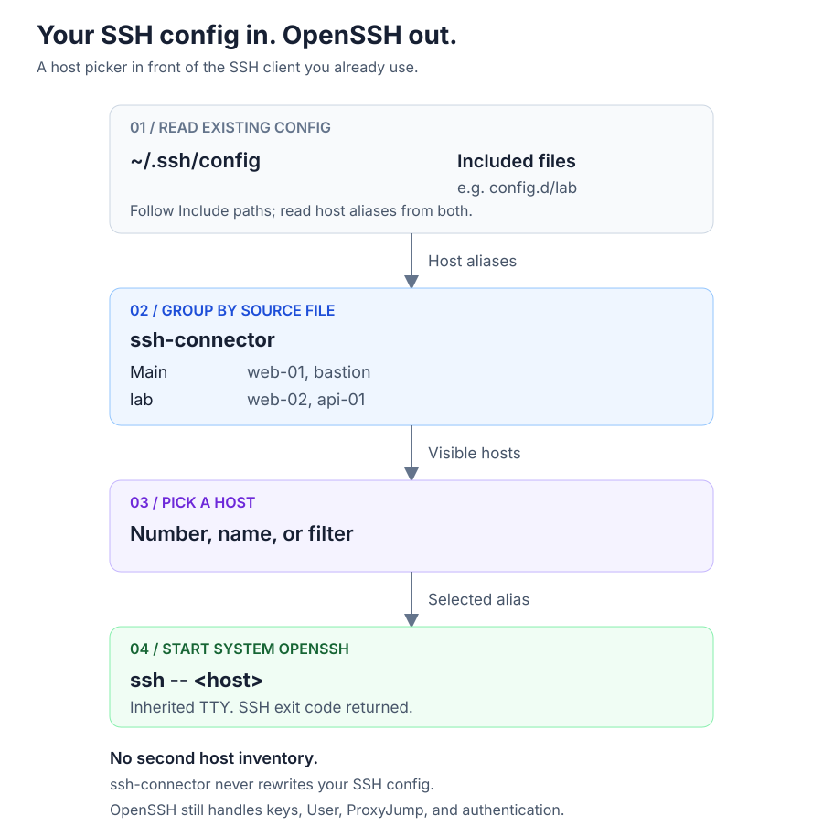

# ssh-connector

Pick a host from your `~/.ssh/config` in a grouped menu, then connect with OpenSSH.

[](https://crates.io/crates/kkamji-ssh-connector)
[](https://github.com/KKamJi98/ssh-connector/actions/workflows/release-please.yml)
[](LICENSE)


**Your config. Your keys. Your SSH client.** No second host inventory and no Python runtime.
The demo records the real binary with fictional config files and a **fake `ssh`** that prints its arguments. It makes no network connection.
[Watch the MP4](https://raw.githubusercontent.com/KKamJi98/ssh-connector/main/docs/demo/ssh-connector.mp4) or [reproduce the recording](docs/demo/README.md).

## Why ssh-connector?

| Without a picker | With ssh-connector |
|---|---|
| Open your SSH config and included files to find an alias. | See aliases grouped by the file they come from. |
| Remember the alias, then type `ssh <host>`. | Pick a number or name, or filter the menu first. |
| Maintain keys, users, and jump routes in OpenSSH. | Keep doing exactly that. Only host selection changes. |

It is a small menu in front of OpenSSH, not a new SSH client.

## Installation

### Homebrew (macOS, Linux)

```bash
brew install KKamJi98/tap/ssh-connector
```

### Cargo

```bash
cargo install --locked kkamji-ssh-connector
```

The **crate** is `kkamji-ssh-connector`; the **command** is `ssh-connector`.
The crate named `ssh-connector` belongs to a different project. If you installed that crate with Cargo, Cargo will refuse to overwrite its same-named binary. Uninstall the unrelated crate first or use Homebrew.

### Prebuilt binaries

Download an archive from [GitHub Releases](https://github.com/KKamJi98/ssh-connector/releases/latest), extract it, and put `ssh-connector` (or `ssh-connector.exe`) on your PATH.

| Platform | Archive suffix |
|---|---|
| macOS, Apple silicon | `aarch64-apple-darwin.tar.gz` |
| macOS, Intel | `x86_64-apple-darwin.tar.gz` |
| Linux, x86_64 | `x86_64-unknown-linux-musl.tar.gz` |
| Linux, arm64 | `aarch64-unknown-linux-musl.tar.gz` |
| Windows, x86_64 | `x86_64-pc-windows-msvc.zip` |

Archive names start with `ssh-connector-<tag>-`. Each has a `.sha256` file and build provenance. For example, verify a downloaded archive with:

```bash
# Replace <tag> and <target> with the values in your downloaded file name.
gh attestation verify ssh-connector-<tag>-<target>.tar.gz --repo KKamJi98/ssh-connector
```

**OpenSSH must be installed and `ssh` must be on PATH.** On Windows, enable the OpenSSH Client optional feature. The default config is `%USERPROFILE%\.ssh\config`.

<details>
<summary>Moving from the old PyPI package</summary>

Versions through `0.3.1` were Python packages. New releases are Rust binaries; `0.3.1` remains on PyPI.
Remove the old tool with the installer you used, then install the new binary:

```bash
uv tool uninstall ssh-connector
# If you used pipx instead: pipx uninstall ssh-connector
brew install KKamJi98/tap/ssh-connector
```

To go back, uninstall the Homebrew formula, then run `uv tool install ssh-connector==0.3.1`.

</details>

## Quick start

Run `ssh-connector` for the full grouped menu shown in the demo. Enter a number or host name to connect, `f` to filter, or `q` to quit.

The examples below use the [same fictional fixture](docs/demo/setup.sh) as the GIF. The output comes from the real binary. The connection example uses the explicitly labelled fake SSH client, not a real server.

### 1. Open the menu already filtered

```bash
ssh-connector web
```

```text
    Main (1)
╔═════╤════════╗
║ No. │ Host   ║
╟─────┼────────╢
║ 1   │ web-01 ║
╚═════╧════════╝
    lab (2)
╔═════╤════════╗
║ No. │ Host   ║
╟─────┼────────╢
║ 2   │ web-02 ║
║ 3   │ web-03 ║
╚═════╧════════╝
```

The next line asks for a host number or name. Enter `2` to select `web-02`. Numbers refer to the **current** menu and change after filtering.

### 2. Connect directly by exact alias

```bash
ssh-connector web-02
```

```text
Connecting to web-02...
[demo ssh] argv: <--> <web-02>
[demo ssh] Connected to a fictional host. No network used.
```

A case-insensitive exact match connects immediately. Any other query opens a substring-filtered menu.
With the real SSH client, this starts `ssh -- web-02` and hands over the terminal.

### 3. List matching aliases for a script

```bash
ssh-connector --list web
```

```text
web-01
web-02
web-03
```

Omit `web` to list all aliases, one per line, in menu order. `--list` does not connect.

### 4. Read a different SSH config

```bash
ssh-connector -F ./ssh_config --list web
```

```text
web-01
web-02
web-03
```

Here `./ssh_config` contains the fixture's main config. Without `--list`, a connection also passes `-F ./ssh_config` to SSH. Relative `Include` paths still resolve from `~/.ssh`, not from the alternate file's directory.

## How it works



The picker reads aliases and never rewrites your config. The SSH child process inherits the terminal; OpenSSH handles authentication, keys, `User`, `ProxyJump`, and the connection itself.

## Commands and options

```text
Usage: ssh-connector [OPTIONS] [QUERY]
```

| Argument or option | Behavior |
|---|---|
| `[QUERY]` | Connect immediately if it matches a host name; otherwise open the filtered menu. |
| `--list` | Print host names in menu order, one per line, and exit. Honors `QUERY`. |
| `-F, --config <FILE>` | Read another config. Connections pass it to SSH as `-F FILE`. |
| `-h, --help` | Print help. |
| `-V, --version` | Print version. |

| Menu input | Behavior |
|---|---|
| Number or host name | Connect to a host in the displayed menu. Names are case-insensitive. |
| `f` | Ask for a substring filter, then show matching hosts. |
| `q` or Ctrl-D | Quit without connecting. |
| Ctrl-C | Interrupt and exit with `130`. |

The tool returns SSH's exit code. A missing `ssh` command exits with `127`.

## Limits and caveats

- **Not an SSH client.** It starts the system `ssh` on PATH as a child process. Authentication, keys, and jump routes belong to OpenSSH.
- **Groups come from files, not comments.** The main file is `Main`; included files use their file names. Conflicting file names are labelled by path.
- Names containing `jump` (case-insensitive) move to a final `JUMP-HOSTS` table with a source-group column. `bastion` is not a special name.
- Names ending in `-ignore` or containing `github` or `bitbucket` (case-insensitive) are hidden. Wildcard/negated patterns and names starting with `-` are not listed.
- The picker reads every `Include`, even inside a conditional `Host` or `Match` block. It does not implement OpenSSH's full conditional configuration semantics.
- `Include` supports globs, `~`, and `${VAR}`. `%` tokens and `~otheruser` expansion are not supported.
- A host defined in two files can appear once in each group. `--list` deduplicates aliases.
- Completion reads the default `~/.ssh/config`, even when you pass `-F`.
- **Windows requires OpenSSH Client.** Real-device connections and Ctrl-C delivery while the actual `ssh.exe` runs have not been verified. CI uses a fake SSH executable.
- **Cargo name collision:** this project's crate is `kkamji-ssh-connector`, not the unrelated `ssh-connector` crate. Both install a command named `ssh-connector`.

See [the roadmap](docs/ROADMAP.md) for possible improvements and [Rust migration notes](docs/rust-migration.md) for compatibility decisions and verification boundaries.

## Shell completion and config

Homebrew installs completion scripts. With another installation method, add the appropriate line to your shell startup file:

```bash
source <(COMPLETE=bash ssh-connector)  # ~/.bashrc
source <(COMPLETE=zsh ssh-connector)   # ~/.zshrc
COMPLETE=fish ssh-connector | source   # ~/.config/fish/config.fish
```

No separate app configuration is needed. Keep aliases in your SSH config and split groups with `Include`:

```sshconfig
Include config.d/*

Host web-01
    HostName web-01.example.invalid
    User demo
```

Put another host in `~/.ssh/config.d/lab` to give it the `lab` group. Group labels are file names, not `#` comments.

## Companion tools

- **[wtree](https://github.com/KKamJi98/wtree)** (`wt`): manage many git worktrees from one bare clone - create, sync, and clean them up.
- **[awspick](https://github.com/KKamJi98/aws-profile-pick)**: pick an AWS profile from a grouped, filterable list.
- **[prjump](https://github.com/KKamJi98/prjump)** (`prj`): jump from the current branch to the new pull request page on GitHub or Bitbucket Cloud.
- **[ssh-connector](https://github.com/KKamJi98/ssh-connector)**: pick a host from your `~/.ssh/config`, grouped, and connect.

## Contributing

Bug reports and focused pull requests are welcome. Start with the [roadmap](docs/ROADMAP.md) and run:

```bash
cargo fmt --check
cargo clippy --all-targets --locked -- -D warnings
cargo test --locked
```

Tests include golden fixtures from the last Python release and fake-SSH integration tests. To change a demo, [re-record and inspect its frames](docs/demo/README.md); never record a personal SSH config.

Commits use Conventional Commits (`<type>: <summary>`, no scopes). release-please opens the version PR; merging it triggers the binary, Homebrew, and crates.io release workflow.

## License

[MIT](LICENSE).
